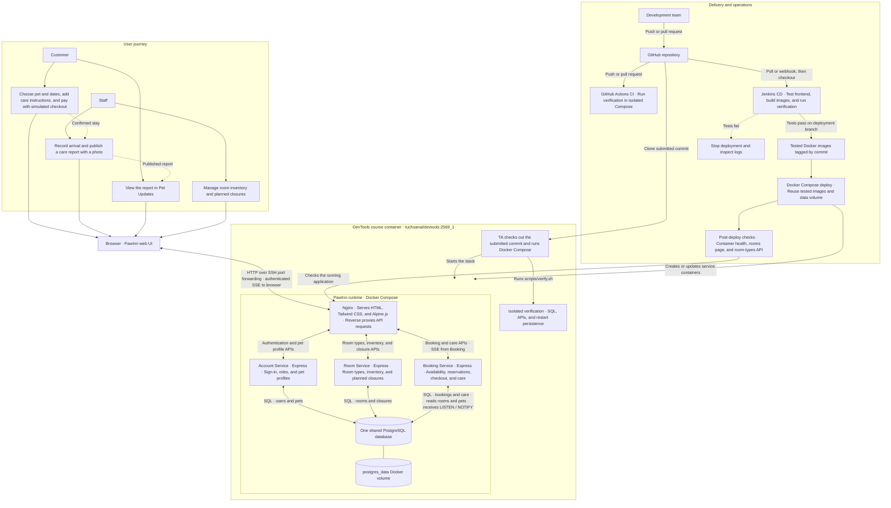

# PawInn

PawInn เป็นเว็บจองโรงแรมสำหรับสุนัขและแมว ลูกค้าดูห้องว่าง จองห้อง ระบุวิธีดูแลเพิ่มเติม และติดตามสัตว์เลี้ยงระหว่างเข้าพักได้ ส่วนพนักงานจัดการห้องพัก พิจารณาคำขอเปลี่ยนการจอง และบันทึกการดูแล

**การชำระเงิน การปรับยอดเมื่อเลื่อนวัน การคืนเงิน และค่ารับสัตว์เลี้ยงล่าช้าเป็นรายการจำลองทั้งหมด**

## ติดตั้งใน DevTools course container

สำหรับการส่งงาน ให้รัน Docker Compose ของ PawInn **ภายใน course container** ที่ใช้ image `tuchsanai/devtools:2569_1` เครื่องของคุณจะเข้าถึง PawInn และ Jenkins ผ่าน SSH port forwarding [คู่มือ DevTools](https://github.com/Tuchsanai/DevTools/blob/main/00_Tool/00_Reference/readme.md)

### 1. เปิด course container และเชื่อมต่อ

เปิด Docker บนเครื่องของคุณ แล้วรันใน PowerShell หรือ Terminal

```sh
docker run -dit --name devtools --privileged -p 127.0.0.1:2222:22 tuchsanai/devtools:2569_1
ssh -o ExitOnForwardFailure=yes -p 2222 -L 127.0.0.1:8082:127.0.0.1:8080 -L 127.0.0.1:8083:127.0.0.1:8081 root@127.0.0.1
```

ถ้ามี container ชื่อ `devtools` ที่เปิดพอร์ต SSH `2222` อยู่แล้ว ให้ข้าม `docker run` ถ้า container หยุดอยู่ ให้รัน `docker start devtools` ก่อนเชื่อมต่อ ใช้รหัสผ่าน SSH จากคู่มือวิชาและเปิดหน้าต่าง SSH ค้างไว้ระหว่างใช้งาน

### 2. ดาวน์โหลดโปรเจกต์และตั้งค่า .env

รันคำสั่งต่อไปนี้ **ในหน้าต่าง SSH** ถ้าเคย clone แล้ว ให้เข้าโฟลเดอร์ PawInn เดิมได้เลย

```sh
docker info --format '{{.ServerVersion}}'
cd /workspace
git clone https://github.com/Alexandria-IT/PawInn.git
cd PawInn
```

รันบล็อกนี้จากโฟลเดอร์ PawInn เพื่อเตรียม `.env` ไฟล์เดียวสำหรับทั้ง PawInn และ Jenkins ระบบจะสร้างรหัสผ่านฐานข้อมูลและ JWT secret ตอนสร้างไฟล์ครั้งแรก ส่วนโปรเจกต์ที่มี `.env` อยู่แล้วจะเพิ่มรหัสผ่าน Jenkins เฉพาะเมื่อยังไม่มีค่านั้น

```sh
(
  set -eu
  umask 077
  if [ ! -f .env ]; then
    db_password="$(node -p "require('node:crypto').randomBytes(24).toString('hex')")"
    jwt_secret="$(node -p "require('node:crypto').randomBytes(32).toString('hex')")"
    sed -e "s/^POSTGRES_PASSWORD=.*/POSTGRES_PASSWORD=$db_password/" \
      -e "s/^JWT_SECRET=.*/JWT_SECRET=$jwt_secret/" .env.example > .env
  fi
  if ! grep -q '^JENKINS_ADMIN_PASSWORD=' .env; then
    jenkins_password="$(node -p "require('node:crypto').randomBytes(16).toString('hex')")"
    printf '\nJENKINS_ADMIN_PASSWORD=%s\n' "$jenkins_password" >> .env
  fi
)
```

ก่อนรัน PawInn ครั้งแรก ให้เลือก `PAWINN_SEED_DEMO` ใน `.env`

| ค่า | ข้อมูลที่ได้เมื่อเริ่มด้วย database volume ใหม่ |
| --- | --- |
| `true` (ค่าจาก `.env.example`) | ห้อง 15 ห้อง พร้อมบัญชี สัตว์เลี้ยง และการจองตัวอย่าง เหมาะสำหรับตรวจงานและเดโม |
| `false` | ห้อง 15 ห้อง ลูกค้าสมัครเองได้ และผู้ดูแลการติดตั้งสร้างบัญชี Staff ตามขั้นตอนด้านล่าง |

PostgreSQL โหลด seed ตอนสร้าง database volume ครั้งแรก การเปลี่ยนค่านี้แล้ว restart จะไม่เพิ่มบัญชีตัวอย่างลงใน volume เดิม ถ้าใช้ฐานข้อมูลเดิม ให้เก็บค่า `POSTGRES_USER`, `POSTGRES_DB` และ `POSTGRES_PASSWORD` ที่ใช้สร้างฐานข้อมูลนั้น [คู่มือฐานข้อมูล](database/README.md)

### 3. เปิด PawInn

รันจากโฟลเดอร์ PawInn ในหน้าต่าง SSH

```sh
docker compose -p pawinn up -d --build --wait
docker compose -p pawinn ps
```

เมื่อบริการพร้อมใช้งาน ให้เปิดเว็บบนเครื่องของคุณ [PawInn](http://127.0.0.1:8082)

ถ้าเปิด demo seed ตั้งแต่ตอนสร้าง volume ให้ใช้บัญชีด้านล่าง ทุกบัญชีใช้รหัสผ่าน `PawInnDemo123!` [ไฟล์ seed บัญชี](database/account/seed.sql)

| บทบาท | ชื่อ | อีเมลสำหรับเข้าสู่ระบบ |
| --- | --- | --- |
| Customer | Jamie Parker | `jamie@pawinn.demo` |
| Customer | Alex Morgan | `alex@pawinn.demo` |
| Staff | PawInn Team | `team@pawinn.demo` |

<a id="run-jenkins-in-docker"></a>

### 4. เปิด Jenkins สำหรับเดโม CI/CD

รันคำสั่งนี้ในหน้าต่าง SSH จากโฟลเดอร์ PawInn ใช้ `.env` ที่เตรียมในขั้นตอนที่ 2

```sh
docker compose --env-file .env -f infra/jenkins/compose.yaml up -d --build
```

เปิด Jenkins บนเครื่องของคุณ เข้าสู่ระบบด้วยชื่อผู้ใช้ `admin` (หรือค่า `JENKINS_ADMIN_ID` ถ้าตั้งไว้) และรหัสผ่านจาก `JENKINS_ADMIN_PASSWORD` ใน `.env` จากนั้นเลือก **pawinn → Build Now** [Jenkins](http://127.0.0.1:8083)

ตามค่าเริ่มต้น Jenkins จะดึงโค้ดจาก `main` บน GitHub รันการทดสอบ แล้ว deploy images ที่ผ่านการทดสอบลงใน Compose project `pawinn` ซึ่งเป็น project เดียวกับขั้นตอนที่ 3 ถ้าใช้ fork หรือ branch อื่น ให้ใส่ `PAWINN_REPO_URL` และ `PAWINN_BRANCH` ใน `.env` ก่อนเปิด Jenkins

<a id="set-up-staff-access"></a>

## สร้างบัญชี Staff

ใช้บัญชีตัวอย่างได้เมื่อเปิด demo seed หรือสร้างบัญชี Staff จาก Account container หลังจากเปิด PawInn แล้ว ใช้อีเมลที่ยังไม่เคยสมัครและตั้งรหัสผ่านอย่างน้อย 12 ตัวอักษรและไม่เกิน 72 ไบต์

```bash
read -r -s -p 'New PawInn staff password: ' staff_password
printf '\n'
printf '%s\n' "$staff_password" | docker compose -p pawinn exec -T account node create-staff.js staff@example.com "PawInn Staff"
unset staff_password
```

เข้าสู่ระบบด้วยบัญชีใหม่เพื่อเปิด **Staff dashboard**

## ทดลองใช้งาน

1. **Customer** สมัครผ่าน **Sign in → Create an account** แล้วเพิ่มสัตว์เลี้ยงใน **My pets** ไปที่ **Our rooms** เลือกสัตว์เลี้ยง วันที่ และห้อง ระบุวิธีดูแลเพิ่มเติม แล้วชำระเงินจำลอง ระหว่างที่ห้องถูกจองชั่วคราว สามารถแก้รายละเอียดได้ที่ **Edit booking details**
2. **เปลี่ยนการจอง** เปิด **My bookings → View details** ของรายการที่ยืนยันแล้วและยังไม่ถึงวันเข้าพัก จากนั้นส่งคำขอยกเลิกหรือเลื่อนวัน สำหรับการเลื่อนวัน ให้ตรวจยอดใหม่และส่วนต่างก่อนส่ง ระบบจะเก็บวันเดิมไว้จนกว่า Staff จะอนุมัติ
3. **Staff** เปิด **Change requests** เพื่อพิจารณาคำขอ และเปิด **All bookings → Stay care** เพื่อบันทึกเวลามาถึงและรับกลับ บันทึกการดูแล และเผยแพร่รายงานประจำวันพร้อมรูป ใช้ **Send a quick update** เพื่อส่งข้อความหรือรูปเพิ่มเติม
4. **Customer** ดูรายงานและข้อความได้ที่ **Pet Updates** แล้วเลือก **View stay care** เพื่อดูประวัติการดูแล ประวัติยังเปิดได้จาก **My bookings → View details → Care during stay** หลังรับสัตว์เลี้ยงกลับแล้ว

เริ่ม Check-in ได้ตั้งแต่ **12:30 น.** ของวันแรกตามเวลากรุงเทพฯ และ Staff ต้องบันทึกการมาถึงก่อนเที่ยงคืน หากเลยเที่ยงคืนโดยไม่มีบันทึก ระบบจะยกเลิกการจองและปล่อยห้องโดยไม่คืนเงิน กำหนดรับกลับคือ **12:00 น.** ของวัน checkout หากรับช้า ระบบคิดค่าธรรมเนียมจำลอง **100 บาทต่อชั่วโมง โดยปัดเศษขึ้นเป็นชั่วโมงเต็ม**

## ทดสอบและแก้ปัญหา

- **ทดสอบในเครื่อง** รัน `sh scripts/verify.sh` ในโฟลเดอร์ PawInn สคริปต์จะสร้าง Compose stack และฐานข้อมูลแยกสำหรับทดสอบบัญชี การจอง และการดูแล แล้วลบ stack ทดสอบเมื่อเสร็จ GitHub Actions ใช้สคริปต์นี้เมื่อ push หรือเปิด pull request [ขั้นตอนเก็บหลักฐานสำหรับเดโม](docs/local-demo.md)
- **ตรวจ container** ใช้ `docker compose -p pawinn ps -a` ดูสถานะ และ `docker compose -p pawinn logs --tail=100` ดูข้อความล่าสุด ตรวจ API ได้ด้วย `curl -fsS http://127.0.0.1:8080/api/room-types` จากหน้าต่าง SSH
- **หยุดและเปิดใหม่** ใช้ `docker compose -p pawinn stop` และ `docker compose -p pawinn up -d --wait` ตามลำดับ ข้อมูลจะอยู่ใน Docker volume `pawinn_postgres_data` ส่วน `docker compose down -v` จะลบ volume ด้วย
- **พอร์ตซ้ำ** ถ้าพอร์ตใน course container ถูกใช้อยู่ ให้แก้ `FRONTEND_PORT`, `POSTGRES_PORT` หรือ `JENKINS_PORT` ใน `.env` ตามบริการที่ชน ถ้าแก้พอร์ตเว็บหรือ Jenkins ให้แก้พอร์ตปลายทางในตัวเลือก `ssh -L` ด้วย ถ้าพอร์ต `8082` หรือ `8083` ชนบนเครื่องของคุณ ให้แก้พอร์ตฝั่งแรกใน `-L` และเปิดเว็บด้วยพอร์ตใหม่นั้น

## โครงสร้างโปรเจกต์

| โฟลเดอร์ | หน้าที่ |
| --- | --- |
| `frontend/` | หน้าเว็บ HTML, Tailwind CSS และ Alpine.js พร้อม Nginx สำหรับเสิร์ฟหน้าเว็บและส่งคำขอไปยัง API |
| `services/account/` | สมัครสมาชิก เข้าสู่ระบบ และจัดการโปรไฟล์สัตว์เลี้ยง |
| `services/room/` | รายการประเภทห้องและการจัดการห้องพัก |
| `services/booking/` | ตรวจห้องว่าง จอง ชำระเงินจำลอง เปลี่ยนการจอง บันทึกการดูแล และส่ง Pet Updates |
| `database/` | PostgreSQL schema รายการห้อง และข้อมูลตัวอย่าง |
| `infra/jenkins/` | การตั้งค่า Jenkins สำหรับเดโม |
| `scripts/` และ `tests/` | สคริปต์ตรวจสอบระบบและ integration tests |

Backend ทั้งสามบริการใช้ Node.js และ Express เชื่อมต่อ PostgreSQL ฐานเดียวกัน [คู่มือ API](docs/api.md) · [คู่มือฐานข้อมูล](database/README.md) · [การแบ่งงานในทีม](docs/team.md)

## สถาปัตยกรรมระบบ


